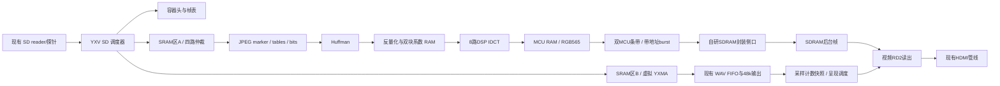

# YXV MJPEG 解码器设计（待审阅）

冻结实现基线为 `main@3397925`，工作分支为 `feat/mjpeg`；本次只从 `main@416189e` 原样取入并完整阅读 [TASK_S1S2_SRAM.md](TASK_S1S2_SRAM.md)，不合入任何实现改动。当前交付为S1-B/S2-A设计修订，待审阅，不授权启动代码阶段。此前D0设计稿已审阅、D1已交付；Python模型/转换器的已实现部分与结果见 [D1验证报告](D1_MJPEG_REPORT.md)。以下RTL文件/端口仍为拟实现规格，不代表已有RTL或板上性能。初赛固件及厂商 IP 保持冻结。

依据：[HANDOFF_FULL.md §10](HANDOFF_FULL.md#10-进行中yxv-视频管道)、[YXV_FORMAT.md §7](YXV_FORMAT.md#7-硬件消费模型)，并核对了 SD 探针、`sd_stream_reader_core`、SDRAM 自研控制封装、BMP 写入器、显示读出器和 WAV 播放器的现有接口。

## 1. 方案与适用范围

首版选 **50 MHz 解码、8 路乘加复用的两遍 IDCT、动态 DHT/DQT、RGB565、640×480 原尺寸居中显示**。所有熵解码、反量化、IDCT、色彩转换、地址运算均在 `sys_clk` 域；100 MHz 域只做 SDRAM 突发接入；pix 域只保留寄存后的读出、黑边选择和音频计数快照。首版不做缩放，避免将“640×480 播放”暗换成 720p 全幅写入。

BRAM目标改为新增 **15块、总54/64，余10块**；DSP仍为13个。原7.6K LUT只是解码/播放器估算，SD流水/SRAM控制/环形队列/仲裁暂增900 LUT预算占位（合计8.5K，非实测），最终受§7逐阶段综合门禁约束。DSP 类型/打包方式最终以 TD 映射报告确认，禁止把宽乘法静默综合成 LUT。

实时能力针对“可接纳素材”而非任意合法 JPEG：固定 640×480@24，单帧含 JPEG 头不超过 40 KiB，帧数不超过 512，且通过后述复杂度及实际 SD 服务率检查。纹理过密的素材需要降低 JPEG 质量或拒绝转换，不能用平均码率掩盖最坏帧。完整 4 分钟曲目与任意尺寸不属于首版。

### 1.1 先纠正带宽口径

| 项目 | 计算 | 结果（十进制 MB/s） |
|---|---|---:|
| MCU / 帧 | 640/16 × 480/16 | 1,200 |
| 8×8 块 / 帧 | 1,200 × (4Y + Cb + Cr) | 7,200 |
| RGB565 写入 / 帧 | 640 × 480 × 2 | 614,400 B |
| 视频有效写入 | 614,400 × 24 | **14.7456** |
| PCM 音频 | 48,000 × 2 声道 × 2 B | **0.192**（走 SRAM 区B/WAV，不写 SDRAM） |
| 显示保守预留 | 沿用现有系统约束 | **110** |
| 显示 + 视频有效数据 | 110 + 14.7456 | **124.7456 < 150** |

交接文档中的约 11 MB/s 不能作为 RGB565@24 的写入值。剩余 40 MB/s 还要覆盖短突发、换向和刷新等损失；本稿不把 25.25 MB/s 的差额全部承诺给其他功能。

## 2. 现有接口差异及集成决策

### 2.1 单 SD 总线必须分时，不能把音视频当成两条物理通道

现有 `yingxu_sd_integration_probe.v` 通过参数固定 `SECTOR_COUNT`，顶层实例为 **5401**；`restart` 仅在空闲后启动，不能抢占正在读取的事务。其内部 `sd_stream_reader.v` 已具有运行时 `sector_count[15:0]`、`busy`、`done`、`stream_first/last`。底层一次 CMD17 把一个扇区读入 RD_RAM，再用 SET/GET 两拍吐一个字节，读卡与吐流不重叠。

后续在自研探针封装增加兼容默认值的动态事务入口，把调度器锁存的 LBA/count 送给现有 reader，向上导出真实完成脉冲；旧照片/音乐/卡带仍用默认 5401。**不复制第二套 SD 控制器，不改厂商命令层。** 使用事务拥有者锁存值对 `valid` 和 `ready` 同时分流：音频、表、JPEG 中只有一个接收者能看到有效字节，不能继续盲广播。

视频模式下每次最多读 8 个连续扇区（4 KiB），事务结束才允许切换音频。JPEG 的 reservoir、DHT、预测器和 MCU 状态跨事务保留；SD 读请求边界不是 JPEG 帧边界。帧尾只向解码器交付表中 `len` 字节，余下扇区填充仍握手排空。物理板上 LBA 为 `slot_base + file_offset/512`；**板上不减 2048**，那是 PC 原始卷写卡时的补偿。

### 2.2 现有 WR2 不能伪装成随机地址写口

已核对：`i_wr2_addr/max_addr/len/load` 配置的是顺序 FIFO 窗口，不是每字地址；FIFO 的 `aempty` 阈值固定为 127，攒够 128 个 32-bit 字才会调度。`WR2_USE` 当前未连接，也没有写入已落 SDRAM 的完成确认。简单把 `len` 改成 8 或反复 `LOAD` 都不成立，`LOAD` 也不负责清掉所有在途写入。

MCU 是 16×16，而目标帧是线性行存储。完整一条 MCU 行重排需要 `640×16×2=20,480 B`，单这一项就约 20 块 BRAM，叠加音频/表/IDCT 会超过余量，故不用全宽条带缓存。

选取**两个相邻 MCU 组成 32×16 小条带**，RGB565 双 bank 各 1 KiB。每条带按 16 行输出，每行是 16 个 32-bit 字的连续突发：

`word_addr = back_base + y*320 + (x>>1)`，`data[31:16]=左像素`、`data[15:0]=右像素`。

后续给 `yingxu_sdram_framebuffer.v` 及其**自研** `yingxu_sdram_control_4port.v` 增加视频带地址突发侧口；保留原 WR2 照片通路。新侧口把已完整缓存的 16 字突发接入现有 `mADDR/mLENGTH/mDATAIN/IN_REQ/mWR_DONE` 调度，在自研封装里补充拥有者、流控和提交确认。复用原命令/数据路径，不改 `src/5640/`、`al_ip/` 或 HDMI enc IP。它是必要的后续集成改动，**不是现有 WR2 已支持的能力**。

正常数据按 16 字一组，命令发布前全部数据必须已在异步 FIFO 可见；不能让 SDRAM burst 中途等 `ready`。仅非活动视频模式保持旧仲裁行为；视频模式对读端紧急状态优先，其余时隙给完整待发视频写 burst，禁止读请求永久饿死写端。最后一个 `mWR_DONE` 才产生 frame commit，FIFO 接收完成不等于落盘完成。

### 2.3 PCM 与 WAV 的真实接法

YXV 音轨是裸 PCM，不能直接送到寻找 `YXMA` 的 WAV 解析器。`yingxu_yxv_pcm_bridge` 在第一次 PCM 前合成 32 B YXMA 头（2 声道、16 位、48000 Hz、frames=`audio_bytes/4`），然后从 SRAM 区B的64 KiB音频环形队列连续送字节，握手接现有 `u_wav.sd_data/sd_valid/sd_ready`。

视频模式下屏蔽 `wav_base/wav_restart` 对物理 SD 的控制；调度器独立维护 PCM 文件游标。WAV 原有 chunk 请求只记录，不用于重新插头或跳扇区；chunk 长度是 4 的倍数，跨 chunk 保持 L/R 字节相位。EOF 后不喂下一轮头，等尾部 FIFO 样本播完后结束，由 YXV 控制器统一重新开始。不要在“最后一个 PCM 字节已入 FIFO”时清掉 `music_active` 截掉尾音。

现有WAV FIFO物理为1024个立体声采样帧，水位768帧约16ms，仍使用现有BRAM。原4096×8 PCM reservoir移到SRAM区B，释放4块BRAM。区B本身65536/192000=341.33ms，加WAV约357.33ms，**不能单独保证400ms**；§8.2.2列出不隐瞒容量缺口的待审补齐方案。


### 2.4 呈现与时钟

首版增加视频专用 RD2 读出分支：线性 640×480 RGB565，显示在 720p 的 `(320,120)..(959,599)`，外部黑边。沿用 128-word RD2 burst、垂直消隐期 LOAD/预取和像素对顺序；窗口外不消耗视频数据，不每行 LOAD。现有照片显示分支保持原逻辑。视频侧另有`rd_flush_req/ack:1`（P↔M toggle）及`cfg_base:21,cfg_max:21,cfg_len:9`稳定配置总线，全部锁存确认后再读。窗口判定、RGB、DE/HS/VS 对齐均寄存，新增输出选择最多一级 mux；禁止把 IDCT、除法、色彩转换或可变移位放进 pix 原有组合链。

视频模式复用 SDRAM，两槽建议按 32-bit 字地址保留 `[0x100000,0x130000)`、`[0x130000,0x160000)`，每槽实际用 `0x25800` 字（614,400 B），合计预留 1.5 MiB，末端小于 `0x200000`（8 MiB）。进入视频模式先停照片加载/轮播，退出后照片重新加载，不能把这两槽与旧照片 scratch 当成同时有效内容。

实际RD2 FIFO当前也只接全局reset，`RD2_LOAD`不清FIFO。视频换槽必须在自研封装里加独立`rd_flush_req/ack`：先停新的RD2 burst并等在途读完成，再通过现有FIFO的reset端口清空旧数据、同步释放、锁存新base及重装地址，最后预取。不要改FIFO厂商文件，也不要复位整个SDRAM控制器。跨域配置用held-bus+toggle确认，不能直接把P域脉冲/21位base接到M域状态机。

双缓冲只在消隐期换前后台；sys 发 `{slot,frame_id,epoch}` 并保持至 pix 应答，pix 在 RD2 完成重装前不提前释放旧前台。写端只能复用已释放槽。第三帧不得覆盖正在显示的槽，阻塞解码即可。初始先解码帧 0，再启动音轨，随后提前准备下一帧；采样计数用于决定**呈现时刻**，不是等到时刻到了才开始读卡解码。

## 3. 模块层次与拟建文件

以下新增 RTL 均在后续审定阶段才创建，Verilog-2001 风格。

```text
src/user_source/hdl_source/media/yxv/
  yingxu_yxv_player.v              顶层、epoch/错误恢复、前后台槽管理
  yingxu_yxv_sd_sched.v            单 SD 分时、音频优先、事务路由
  yingxu_yxv_container.v           YXV 头/512 项帧表/边界校验
  yingxu_yxv_pcm_bridge.v          SRAM区B环形缓冲、虚拟 YXMA 头 → 现有 WAV
  yingxu_yxv_avsync.v              WAV 计数快照、sys 时间轴、呈现 mailbox
  yingxu_yxv_scanout.v             视频模式 RD2 读出、居中黑边
  yingxu_yxv_cdc_fifo.v            数据/描述符 FIFO，Gray 指针、复位 epoch
src/user_source/hdl_source/media/jpeg/
  yingxu_jpeg_decoder.v           组合子模块、每帧启动/错误/完成
  yingxu_jpeg_marker.v            SOI/SOF0/DQT/DHT/DRI/SOS/EOI、RST
  yingxu_jpeg_tables.v            DQT、canonical DHT 构建与查表 RAM
  yingxu_jpeg_bits.v              FF00 去填充、marker 分离、位 reservoir
  yingxu_jpeg_huffman.v           DC/AC 解码、幅值扩展、DC 预测、ZRL/EOB
  yingxu_jpeg_blockbuf.v          双 bank 系数块、清零/反 Z 字序/反量化
  yingxu_jpeg_idct.v              8 DSP、两遍 8×8 整数 IDCT
  yingxu_jpeg_mcu_rgb.v           MCU 双 bank、4:2:0 近邻展开、YCbCr→RGB565
  yingxu_jpeg_fb_writer.v         32×16 RGB 条带双 bank、16-word 行 burst
  yingxu_sdram_vwrite_port.v      burst 数据/描述符跨域、提交确认
```



后续集成触点限于自研顶层、`design_top_wrapper.v`、上述自研 SDRAM 封装、SD 探针适配及 TD 工程源文件注册；转换器约束属于之后独立工具改动。本稿不实施这些改动。

## 4. 接口契约

### 4.1 公共规则与通道类型

S=`sys_clk=50 MHz`，P=`pix_clk≈73.30 MHz`，M=`sdram_ctrl_clk=100 MHz`。各模块有其域的 `clk:1`、`rst:1`（高有效、释放在本域同步）；跨域 FIFO 两侧各有 clk/rst。未特别标注的内部接口均在 S 域。`epoch:8` 随启停/错误恢复递增，清理期间停止接收，旧 epoch 的完成/呈现包必须丢弃。

所有 R/V 通道均有 `valid:1`、反向 `ready:1`；只在二者同高时接受，阻塞期间 valid 及全部 payload 稳定，禁止 ready/valid 组合环。脉冲不是 R/V：必须注明只有一个周期，跨域改用 FIFO/mailbox。错误 `err_valid:1,err_code:8` 锁存到清帧，顶层统一处理；计数器除明确模计数外均饱和并报错。

| 通道 | payload（逐字段位宽） | 语义 |
|---|---|---|
| `SDREQ` | `lba:28, nsector:16, owner:2, tag:8` | owner=表/JPEG/PCM；只在 reader 空闲提交，count=1..8 |
| `BYTE` | `data:8, last:1` | last 指本通道对象结束；JPEG 为有效 len 的最后字节，不含扇区填充 |
| `FRAME` | `id:9, offset:32, length:32` | 文件内绝对偏移及 JPEG 有效字节数 |
| `TABWR` | `kind:3, tid:1, index:8, value:8` | kind=0:DQT、1:DC counts、2:DC symbols、3:AC counts、4:AC symbols；一张表收齐后发携带kind/tid的R/V commit |
| `TOKEN` | `block:3, mcu_x:6, mcu_y:5, k:6, qcoeff:s16, write_coef:1, block_last:1` | block=Y0/Y1/Y2/Y3/Cb/Cr，k为zigzag序号；EOB发送write_coef=0的结束token，ZRL只推进索引；不能丢掉全零块的结束事件 |
| `BLOCK` | `bank:1, block:3, mcu_x:6, mcu_y:5` | bank 中完整 64 项反量化系数，可被 IDCT 占有到 release |
| `SAMPLE` | `block:3, x:3, y:3, value:8, last:1` | IDCT 最终裁剪后的 8×8 样本，last 为该块最后一个输出 |
| `PIXEL` | `x:10, y:9, rgb565:16, mcu_last:1` | MCU 内行优先输出，带整帧绝对坐标，不承诺全帧行优先 |
| `WCMD` | `word_addr:21, words:9, tag:16, epoch:8` | words 首版恒 16，tag 标识该帧行 burst；无隐式地址自增跨行 |
| `WDATA` | `data:32, last:1` | 与最早未结束 WCMD 严格对应，last 在第16字 |
| `COMMIT` | `tag:16, epoch:8` | 该 burst 已完成 SDRAM 写，而非仅 FIFO 接收 |
| `PRESENT` | `slot:1, frame_id:9, epoch:8` | 前后台交换 mailbox，必须等待消隐与最终 ack |

### 4.2 控制、SD、音频及显示模块

以下“入/出”均相对于本行模块，通道全部字段采用上表位宽；跨域的位置在时钟列列明。

| 文件 / 模块 | 接口信号（方向） | 域 | 握手及约束 |
|---|---|---|---|
| `yingxu_yxv_player` | 入 `play_valid/ready:1`, `slot_base:28`, `stop:1`；出 `playing:1`, `frame_id:9`, `err_*` | S | play 接收一次锁存槽；stop 为 S 单拍，先排空/丢弃旧 epoch，再停 |
| 同上 | 出 SDREQ、入 SD 完成；入 FRAME；出解码 `start_valid/ready:1, jpeg_bytes:32, back_base:21, frame_id:9`；入 `decode_done:1`、最终 COMMIT；出 PRESENT | S / S↔P | decode_done 只表示 JPEG 结束；还须所有写提交后才能发布后台 |
| `yingxu_yxv_sd_sched` | 入上层读请求、`audio_occ:18`、`jpeg_space:10`；出 SDREQ 对探针；入 `sd_init:1,sd_busy:1,sd_done:1,sd_error:1` | S | 事务不可抢占；PCM 低水位优先，LBA/tag/count 全程锁存 |
| 同上 | 入 `stream_data:8,stream_valid:1,stream_last:1`，出 `stream_ready:1`；出表/JPEG/PCM BYTE | S | 对拥有者的 data/valid/ready 成对路由；完成须收到 nsector×512 字节和 done，不看 sticky done |
| `yingxu_yxv_container` | 入 BYTE；出 FRAME；出 `hdr_valid/ready:1`, `frames:10,width:16,height:16,fps:16,audio_off:32,audio_bytes:32`；入 `lookup_valid/ready:1,id:9` | S | 头先验证再装表；同步表 RAM 查表有显式响应 valid，不能假设零拍读 |
| 同上 | 出 `table_req`（SDREQ 的表拥有者）；出 `err_*` | S | 32+N×8 向上取整读；audio_off 由最后一项 offset+align512(len) 推导；无 audio_off 头字段 |
| `yingxu_yxv_pcm_bridge` | 入 PCM BYTE、`audio_bytes:32,begin:1`；出 `occ:18`；出 `wav_data:8,wav_valid:1`，入 `wav_ready:1`；出 `producer_eof:1` | S | SRAM区B容量65536B；18位计数兼容§8.2.2的可选80KiB模式，合成头也遵守 WAV ready；last 后仅丢弃扇区填充，不插入 PCM |
| 同上 | 入 `wav_restart:1,wav_base:28`，出 `wav_music_active:1` | S | 视频模式隔离物理读请求；维持 active 到真实播放尾部；非视频模式走旧连线 |
| `yingxu_yxv_avsync` | 入 `wav_pops:16,wav_out_ticks:16`；入/出快照 req/ack toggle:1，held snapshot:32 | P↔S | P 收请求后一次锁存两个16位计数并保持，ack 经2FF；S 再取稳定总线，不把二进制计数器逐位2FF |
| 同上 | 出 `samples_played:32,due_id:9`；入/出 PRESENT 与释放 ack | S↔P | ≤0.5ms轮询，16位计数模差扩展32位；同一epoch不能间隔≥65536/48000秒；每2000采样帧推进一次deadline；EOF单独标识，不让第512帧回绕为0 |
| `yingxu_yxv_scanout` | 入 PRESENT；出 `release_slot:1,ack_toggle:1`；入 `pixel_x:11,pixel_y:10,pixel_active:1,video_mode:1` | P | 仅垂直消隐换槽，独立rd_flush握手、LOAD/预取结束再ack；扫描窗口/黑边均寄存 |
| 同上 | 入 `rd2_data:32,rd2_empty:1`；出 `rd2_en:1,rd2_addr/max_addr:21,rd2_len:9,rd2_load:1,rgb:24,underflow:1` | P | 沿用连续行存储与128字 burst；空时不采垃圾；RD2未完成旧读请求前禁止释放旧前台 |
| `yingxu_yxv_cdc_fifo` | 入 `w_data:W,w_valid:1`，出 `w_ready:1`；出 `r_data:W,r_valid:1`，入 `r_ready:1`；两侧 epoch:8 | S↔M | 注册 Gray 指针+2FF；深度为2幂；同步读RAM延迟由 valid 覆盖；恢复握手后再启流 |

采样帧是一个 L/R 对，不是单声道样本。启播前先完成epoch内基准计数快照，再放行music_active；EOF单独结束时间轴。时间轴使用 WAV 的真实 pops，不使用 SD 已读字节或 HDMI 刷新帧数；输出 tick 同时用于检查断流。前台重复时音频继续，下一次选最新已完成且到期的后台；正常接纳素材验收要求不丢帧。59.3Hz 显示与24fps内容不整除，呈现相对音频 deadline 的延迟上限为一次刷新周期加快照误差（约17.4ms），不是承诺每帧恰好保持2或3次刷新。

### 4.3 JPEG 计算模块

| 文件 / 模块 | 接口信号（方向；未另标均 S 域） | 握手及宽度补充 |
|---|---|---|
| `yingxu_jpeg_decoder` | 入 start 与 BYTE；出 `start_ready:1,done:1,err_*`、PIXEL；出 `active_cycles:32,input_wait_cycles:32,output_wait_cycles:32` | 每帧清表有效位、预测器、reservoir及 bank 所有权；done 须 EOI、7200块和307200像素全部吻合 |
| `yingxu_jpeg_marker` | 入 BYTE 与 bits 返回的 `marker_valid/ready:1,marker_code:8`；出 `entropy_enable:1`、TABWR、`commit_valid/ready:1,kind:3,tid:1` | 头段按大端长度消费；JPEG 大端与YXV小端严格分开；段解析不识别元数据中的伪 FFD8 |
| 同上 | 出 `scan_valid/ready:1`, `width/height:16`, `qt_y/qt_c:1`, `dc_y/dc_c/ac_y/ac_c:1`, `dri:16`；出 `restart_valid/ready:1,rst_index:3` | 只在完整合法 SOS 后启熵解码；restart 必须 MCU 边界 |
| `yingxu_jpeg_tables` | 入 TABWR/commit（kind:3,tid:1）；入 `hreq_valid/ready:1,table_sel:2,nbits:5`，出 `hrsp_valid/ready:1,first_code:16,count:8,base:8` | 同步 canonical RAM；table_sel={DC/AC,tid}；code-first<count 才命中 |
| 同上 | 入 `sym_req_valid/ready:1,table_sel:2,index:8`，出 `symbol_valid/ready:1,symbol:8`；入 `qreq_valid/ready:1,tid:1,k:6`，出 `qvalid/ready:1,q:8` | DHT symbol RAM 4×256×8；Q RAM 2×64×8；仅支持的标识范围内查表，禁止缺表默认填零 |
| `yingxu_jpeg_bits` | 入熵区 BYTE；入 `get_valid/ready:1,nbits:5`；出 `bits_valid/ready:1,value:16`；出 marker 通道；入 `align:1` | nbits=0..16，32位 reservoir；FF00 变为一个FF；未消费完marker前不跨marker取位；align只能在块/MCU规定边界 |
| `yingxu_jpeg_huffman` | 入 scan 配置、bits 及table响应；出 TOKEN、`mcu_done:1,mcu_x:6,mcu_y:5`；入 restart；出 `err_*` | AC size≤10、DC size≤11；每分量独立 DC predictor:s16，运算先扩位再检查；不可把block_last当丢失系数的补救 |
| `yingxu_jpeg_blockbuf` | 入 TOKEN、量化表响应；出 BLOCK；入 `block_release_valid/ready:1,bank:1` | 每bank先清64项，zigzag ROM映射至自然顺序；一个DSP乘 qcoeff×Q 后检查范围、写s16；两个bank共128×16 |
| 同上 | 入 `coef_rd_valid/ready:1,bank:1,index:6`，出 `coef_valid/ready:1,value:s16` | BRAM同步读，bank冻结到IDCT完成；EOB后未写项必须确实是0 |
| `yingxu_jpeg_idct` | 入 BLOCK 与 coef读响应；出 SAMPLE；出 `release_valid:1,release_bank:1`（入release_ready:1）、`block_done:1,cycles:16` | 8乘法lane，双遍转置RAM；output stall保留sample及地址，不能继续覆盖MCU槽 |
| `yingxu_jpeg_mcu_rgb` | 入 SAMPLE、`mcu_x:6,mcu_y:5`；出 PIXEL；出 `mcu_release:1` | 两个MCU sample bank，block6齐才允许渲染；一个RAM读口每像素3拍取Y/Cb/Cr，另一口供IDCT写下一bank |
| `yingxu_jpeg_fb_writer` | 入 PIXEL、`back_base:21,frame_id:9,epoch:8`；出 WCMD/WDATA；入 COMMIT；出 `frame_committed:1` | 两MCU条带双bank；只发布完整16字行；最后一burst落SDRAM后才committed |
| `yingxu_sdram_vwrite_port` | S侧入 WCMD/WDATA、出 ready；M侧出 `vwr_valid:1,addr:21,len:9,data:32`，入 `vwr_ready:1,data_take:1`；入 `vwr_done:1`；S侧出 COMMIT | 数据FIFO256×32、描述符FIFO16×64；描述符在全部16字写入后发布，M侧还须等同步后的数据credit≥16；完成事件保持/确认，不能丢M单拍 |

M侧实际接入自研控制器时，`vwr_ready` 只接受一个完整 burst 的控制权，数据随后按 `IN_REQ` 每拍提供；完成等 `mWR_DONE`。全帧9,600个行burst，16位tag足够；配置及epoch高位可在整帧期间稳定保持、mailbox传递，64位描述符以 `{addr:21,len:9,tag:16,epoch:8,reserved:10}` 存储。首选在一块32位宽物理BRAM中分两拍写/读描述符的高低半部，逻辑读写指针仅在整条描述符完成后推进；独立64位宽映射的20块备选总预算见§7。

## 5. JPEG 子集与输入保证

### 5.1 接受的编码

| 项 | 首版决定 |
|---|---|
| JPEG过程 | SOF0，8-bit Baseline sequential DCT，单帧独立完整JPEG |
| 尺寸 | 首版只接收640×480，宽高均16整除，无边缘MCU裁剪分支 |
| 颜色/采样 | 三分量YCbCr，ID为1/2/3，Y采样2×2，Cb/Cr各1×1；MCU块序Y0,Y1,Y2,Y3,Cb,Cr；Cb/Cr必须共用相同的DQT/DC/AC表选择 |
| Scan | 一个交织SOS，三分量齐，Ss=0、Se=63、Ah=Al=0，分量顺序与SOF一致 |
| Huffman | **解析每帧DHT**，DC/AC各支持ID0/1。支持标准表和编码器优化的自定义canonical表；不硬编码“标准表一定存在” |
| 量化 | **解析自定义DQT**，8-bit精度、ID0/1，元素1..255。按zigzag入表，SOF选择对应表；帧间可更换，SOS后不再改表 |
| 语法 | 支持DC差分/符号扩展，AC EOB、ZRL、run/size；拒绝超过系数63、非法size或缺码 |
| RST | 支持DRI及RST0..RST7循环；每规定MCU数丢弃到字节边界、验证填充位、复位三路DC预测器。DRI=0不允许RST；末MCU后直接EOI也可 |
| 容器内元数据 | APPn/COM按段长跳过，头总量≤4KiB；不解释ICC/Exif旋转/Adobe颜色转换，转换器须先归一化像素 |
| 数值边界 | 差分先s17求和；qcoeff×Q先完整乘积，反量化结果必须在[-2048,2047]，越界报错而非截断/环绕 |

12位反量化幅度是该硬件profile的额外限制，不声称覆盖所有语法合法的Baseline码流。普通8-bit图像DCT的量级约1024，包含量化误差后仍有余量；仍必须由软件逐块验证，不能仅相信这一经验范围。

### 5.2 明确拒绝的项目

拒绝 progressive/SOF2、扩展顺序SOF1、12-bit、算术编码、lossless、灰度/CMYK/RGB JPEG、4:2:2/4:4:4、非交织/多scan、分量ID/表ID超上述范围、16-bit DQT、缺省/跨帧沿用表的 abbreviated JPEG、DNL/层次编码、熵区内改表、截断或重叠段，以及超尺寸/帧数/长度/复杂度上限的YXV。

RST不能当普通填充丢弃：顺序错误、过早/过晚、DRI不符、码字跨RST、EOF半个marker都报当前帧失败。失败只丢弃后台，继续显示最后一张已提交前台；不能在未知位边界“跳到下一个FF”然后声称帧有效。预期RST点无额外marker却有EOI，只在刚好完成最后MCU时接受。

### 5.3 转换器端的保证（后续工具任务，不在本稿改动）

当前 `tools/video2yxv.py` **没有固定 pix_fmt，也没有JPEG子集/周期验证**，其现有 verify 仅检查容器的一部分不变量，不能作为本解码器输入合格证。

后续转换命令显式增加 `-c:v mjpeg -pix_fmt yuvj420p -huffman default`，固定640×480、24fps，并在缩放/转色时归一化为JPEG full-range YCbCr（明确BT.601矩阵）。`-q:v` 值越大质量越低；default Huffman只是可重复生成的默认，不限制硬件读取DHT。不要依赖未经确认的 ffmpeg restart 选项名：硬件支持DRI/RST，验证器检查实际段即可。

转换后标准库Python验证器必须逐帧解析marker、完整熵解码，验证上述profile、DHT无过订阅/非法码、DQT值、幅度范围、EOI恰在表len末尾、有效像素数和资源限制；按实际有限bank调度模型计算周期。失败时有界提高q值重转，仍失败则拒绝写卡，不自动改变分辨率/格式。还须检查：

- YXV小端头、version=1/channels=2/rate=48000、fps=24、1≤frames≤512、audio_bytes能被4整除；table_off=32，frames_off在表后且512对齐。
- 每项offset单调且**不重叠**，len>0且≤40KiB；所有加法用至少33位检查溢出和256MiB槽边界。
- audio_off由最后帧推导，audio_off+audio_bytes不越槽；视频/音频时长差<0.1s。首版默认通过补/裁PCM使其精确等于N×2000个立体声采样帧。
- 帧表和所有帧均自足，不把超过512项静默截表；首版21.333秒上限用明确错误提示。长片分段是未来格式/读表任务。
- 写卡仍沿用锁卷、-2048补偿、扇区对齐、回读校验；仅提交合成测试向量的生成器，不提交音乐/视频素材。

## 6. 运算与缓存细节

### 6.1 熵解码与反量化

不采用4×65536的完整Huffman LUT。DHT先构建每表16条 `{first_code:16,count:8,base:8}` 描述符，symbol另存RAM；按码长1..16逐位canonical匹配，描述符同步读按保守**每码位2拍**计，幅值一次从reservoir取0..11位。移位/匹配/符号访问分拍，最大码长不是一条16层组合树。

每块64项先清零，DC放自然索引0；AC累加run并由64×6bit固定ROM反zigzag。TOKEN写DC（含0）及真实非零AC；EOB用write_coef=0的终止token结束，k=63的系数token可直接带block_last，ZRL跳16个零但要检查剩余范围。用1个DSP做带符号反量化；Q必须显式零扩展为正数。系数bank交接只传所有权，不能在IDCT读同bank时清零。

### 6.2 IDCT：8个DSP，避免把稠密矩阵做成64个乘法器

定义 `A[n,k]=C(k)/2*cos((2n+1)k*pi/16)`，`C(0)=1/sqrt(2)`，其余为1；ROM常数 `K[n,k]=round(65536*A[n,k])`（有符号16位）。先对每个频域行作8点变换，存T，再按列作同样变换，最后加128并clip至[0,255]。

一拍读一个输入，广播到8路DSP，各路对应一个输出位置，8拍发完8输入；lane累加器为s40。乘法输入最多s16×s16（放入DSP18×18）；第一遍结果以s16转置缓存，输入幅度限制使其理论绝对值≤约5793，不会溢出。每遍采用 `floor((sum+32768)/65536)` 舍入，负数也必须按这个定义，不能由语言默认右移/round替代。

乘法/加法标签流水，两个累加上下文或独立结果寄存器允许“下一向量计算”和“上一向量8结果串行写RAM”重叠。每遍64拍发射，BRAM读/乘法延迟/尾部8拍排出及切换合计预算≤24拍，故每遍≤88拍、**每块≤176拍**，不是1024拍/块。转置RAM只要单读单写；不需要8个BRAM读口。若综合或实现无法做到这一调度，不得继续引用176拍结论。

Python整数模型与RTL必须逐点bit-exact；独立双精度数学IDCT在上述幅度范围的最终8-bit裁剪输出最大绝对误差门槛为3 LSB（两遍Q16舍入及常数量化的保守界约2.63）。不要求与使用不同IDCT/舍入规则的ffmpeg逐字节相同。

### 6.3 MCU与颜色

MCU RAM双bank共 `2×(256Y+64Cb+64Cr)=768B`，放一块1024×8存储。IDCT可写下一bank；渲染器从另一bank按x/y行序取Y、Cb、Cr，每像素3个RAM读拍，Cb/Cr索引为 `(y>>1,x>>1)`，首版近邻展开。

颜色项的round统一定义为`floor((sum+8192)/16384)`（G的两个乘积先相加再舍入）。JPEG为full-range：`R=Y+round(22970*Cr'/16384)`，`G=Y+round((-5638*Cb'-11700*Cr')/16384)`，`B=Y+round(29032*Cb'/16384)`，Cb'/Cr'=输入-128。4个DSP做4个乘积，寄存加法/舍入/clip，再取R[7:3]、G[7:2]、B[7:3]。禁止混用限幅视频的Y-16公式。

32×16 RGB条带双bank一共2KiB；写左MCU的每行前8字，再写右MCU的后8字，完整后按行发16字burst，不填充无用像素到SDRAM。输出侧接受停顿时回压到MCU/IDCT/熵流，所有bank release都必须经过最后一次有效握手。

## 7. 资源账：PCM搬入SRAM，BRAM增量15块

以下均为增量目标，不是实测；冻结基线10519 LUT / 39 BRAM / 0 DSP保持全部功能。

| 模块组 | LUT原估算 | BRAM9K物理块 | DSP18×18 |
|---|---:|---:|---:|
| YXV头/表、SD调度 | 1200 | 4 | 0 |
| PCM bridge、AV快照（PCM数据改在SRAM B） | 550 | **0** | 0 |
| JPEG marker/bits/原512B输入FIFO | 800 | 1 | 0 |
| DHT/DQT与canonical Huffman | 1400 | 3 | 0 |
| blockbuf/反量化 | 350 | 1 | 1 |
| IDCT | 1450 | 1 | 8 |
| MCU/RGB | 550 | 1 | 4 |
| RGB条带/burst/CDC | 800 | 4 | 0 |
| 视频读出/SDRAM侧口 | 500 | 0 | 0 |
| 原解码/播放器小计 | **7600** | **15** | **13** |
| 新SD流水/SRAM控制/仲裁/环形元数据预算占位 | **+900，须实测** | **0** | **0** |
| 暂定总目标 | **8500** | **15（总54，余10）** | **13** |

SRAM不是帧缓冲：512KiB小于614400B RGB565整帧，图像前后台继续放SDRAM。SRAM读写各算一次总线流量：40KiB×24+PCM=1.175040MB/s载荷，经SRAM一次写、一次读共**2.350080MB/s**，不是0.91MB/s单向就能代表总线负载。持续20MB/s仍有约8.5倍空间，但JPEG瞬时解码读量和仲裁延迟须验证。

### 7.1 SRAM分区（均为字节地址，KiB=1024B）

| 区 | 字节范围（含端点） | 容量 | 用途 |
|---|---|---:|---|
| A | 0x00000–0x5FFFF | 384KiB | JPEG整帧预取环；读写回绕，不当像素缓存 |
| B | 0x60000–0x6FFFF | 64KiB | PCM环，虚拟YXMA仍由bridge合成 |
| C | 0x70000–0x7FFFF | 64KiB | 备用/描述符/可选抗抖扩展，需登记每个占用 |

为避免“12×32KiB刚好满A却还要放描述符”，帧边界描述符拟放C的1KiB小区，A只放JPEG payload（不存SD扇区填充）。若坚持描述符也放A，必须从393216B减去其实际开销，不能仍宣称能放12个完整32KiB帧。§8.2.2给出C的精确待审用途，默认分区表保持384/64/64。

正常64KiB B模式水位为低62KiB/高64KiB；若审定400ms模式，PCM逻辑80KiB水位改为低78KiB/高80KiB，每次补给最多2KiB。不能维持旧2KiB低水位或把80KiB满容量当作所有时刻的有效储备。每次允许SD转向JPEG前，用B当前有效字节、WAV余量和在途扣除量校验PCM可播时长；JITTERCHK还必须从最低允许水位注入，不能只测满缓存。

A达到12帧才停止预取，跌至11帧即安排下一帧填充；每次切换还按时间轴检查“A完整帧+已解码后台的覆盖时长≥400ms+实测恢复读卡/解码最坏余量”。若某个12帧尺寸窗口或最低水位相位不满足该式，必须显式调q/帧率后重验，不声称400ms容限无条件成立。

SRAM物理地址单位为16-bit字：`cmd_addr=byte_addr[18:1]`，byte_en[0]对应偶数字节、[1]对应奇数字节。成对打包读写，奇数帧尾用byte_en完成单字节写；有效长度不含填充。区A384KiB不是2的幂，指针必须比较上界再回绕，禁止位掩码回绕；区B可选扩容后同理。容量与满/空用独立计数区分，不能为区分满空白白浪费一个整帧。

### 7.2 四路仲裁与面积门禁

四个逻辑客户固定为 A写（SD JPEG）、B写（SD PCM）、A读（解码器）、B读（WAV）。描述符读写是A客户的管理子事务，不暗增第五个外部主设备。全部在sys 50MHz域；pix音频仍走现有WAV异步FIFO，控制跨域统一held-bus+toggle，不能把多位SRAM占用值直送pix。

仲裁单位为逻辑组，不逐拍轮转，更不能中途改变四拍控制器事务。B写在低水位时优先（每组最多4扇区=2KiB，且预留空间），B读在JPEG MCU组间按WAV需求及时排队；否则A写按帧预留/按最多8扇区量子进行，A读一旦取得MCU组授权连续服务到其边界。组内控制器每次只接收一个16位命令，owner锁存至rsp；组切换、读写翻转只在上一响应完成后发生。

MCU组最多4KiB输入和1ms授权时间作为保守限额（已支持Baseline的6块长码+FF00也在此字节上界内），下游资源先预留；超过上界或持有者无进展则停帧报错，不能无限锁总线。解码器未请求字节时不忙等占用物理接口；PCM急需读在最近MCU边界获得服务，其他持续等待客户每10ms至少完成一组或自动报饥饿。正式仲裁模型必须证明这些界限与MCU不可抢占同时成立，不能以“25MB/s很快”替代无饥饿证明。

新增SRAM控制与仲裁不允许偷偷再申请BRAM；复用原输入FIFO、少量寄存器skid及C区元数据。JPEG预取描述符走C；原SDRAM跨域16×64命令描述符仍保持单BRAM分两拍打包，不混同于JPEG帧描述符。若综合成两块而突破15块目标，必须停机复审，不能自动用第16块，也不能未经CDC设计就把跨域命令搬到SRAM。8.5K LUT估算只余581 LUT，风险明确高于D1原7.6K；新增逻辑在S1-B、S2-A模块级就要综合，超预算立即重设计，不等D9。

### 7.3 每阶段综合记录（保留30%停机线）

S1-B、S2-A及D2/D3/D4/D5/D6每个小步骤结束，都把当步实际连接加入TD工程综合，记录源码SHA、工具选项、LUT/REG/BRAM/DSP总数与增量、sys/pix时序。累计实测增量相对已完成模块估算的绝对偏差>30%，或估算0而实际新增，即停；硬总预算与pix无新增负裕量优先，低于30%也不能超器件容量。

| 阶段 | 当阶段原估算 LUT/BRAM/DSP | 记录基准 |
|---|---|---|
| S1-B | 少量SD流水寄存器/控制，先独立综合测量 | 冻结基线 |
| S2-A | SRAM新增900 LUT占位，PCM由4块降为0块 | S1-B实测工程；未有JPEG时不能把39块基线误报成54块 |
| D2 | 1300 / 4 / 0 | S2-A合格工程，单列SRAM增量 |
| D3 | 1300 / 4 / 0 | 同上，累计2600/8/0 |
| D4 | 1250 / 1 / 1 | 同上，累计3850/9/1 |
| D5 | 1450 / 1 / 8 | 同上，累计5300/10/9 |
| D6 | 550 / 1 / 4 | 同上，累计5850/11/13 |

其余头/帧表4块使最终BRAM增量15。任务书BRAMCHK为最终预算上限≤15、总≤54；S2-A尚未集成全部JPEG时必须同时报告“当前实际”和“全系统预算”，不能以未实例化模块的零成本声称最终已过。旧 [MJPEG_RESOURCE_LOG.md](MJPEG_RESOURCE_LOG.md) 是D1历史模板，S1/19块条目由本稿取代，执行时按本稿另起测量行，不改写既有D1证据。

## 8. 周期、SD与SDRAM预算

### 8.1 解码核（50MHz）

| 环节 | 每MCU周期预算/模型 | 640×480整帧 |
|---|---|---|
| Huffman+清零+反量化 | `sum(64 + 2*Hbits + 4*Nsymbols + 16 + 2*Stuffed)`，对6块求和；Hbits不含幅值位，4拍符号项含取幅值/查符号/反量化开销，Stuffed为本块FF00次数；每个实际RST另加16拍 | 内容相关；参考模型必须计真实码字、RAM等待、bank占有 |
| IDCT | 6×176 = **1,056** | 1,267,200拍，**25.344ms** |
| MCU读样本+RGB | ≤3×256+16 = **784** | 940,800拍，**18.816ms** |
| 两MCU条带排出到本地FIFO | 每条带256字+切换，摊至每MCU≤144 | ≤172,800拍，3.456ms；不含外部SDRAM等待 |
| 帧周期可用 | 50,000,000/(24×1200) | **1,736.11拍/MCU**；每帧2,083,333.33拍 |

各级通过两块系数bank、两MCU sample bank、两条带bank重叠运行，不把这些整帧时间相加，也不能无条件只取最大值。串行尾部、局部高熵MCU和bank互锁必须由有限缓存的周期参考模型计算。

D1已用完整40KiB帧实跑：均匀分布31.85588ms、前部集中39.53448ms（拒绝），详见 [D1报告](D1_MJPEG_REPORT.md#2-40kib帧的最坏周期结果)。这些是Python模型结果；40KiB尺寸合格不代表周期合格。

接纳规则：先以1344拍/MCU（32.256ms/帧）作为熵级预算线；对复杂度超线的MCU明确标记。最终必须在**完整有限bank调度模型**中、输入随时可用且输出不阻塞时，单帧≤1,750,000拍（35ms，含头表解析与流水排空），否则该q值不接纳。该最终门槛优先于均值；不能只凭“每个模块各自够快”宣称整机24fps。

### 8.2 SD：12.5MHz默认、25MHz可选，平均载荷与抗抖联合验收

采用任务书§1的新系统口径：**含CMD/卡忙/排空/音视频切换的墙钟平均有效载荷≥1.20MB/s，并由512KiB板载SRAM方案吸收≥400ms卡忙**。这替代旧“瞬时持续≥1.50MB/s、SD间隙≤8ms”的整机硬条件；8ms只保留为SRAM到WAV服务间隙的内部目标。BANDCHK、EFFCHK与该平均值分开记录，不混用分母。

| 项 | 预算/验收 |
|---|---|
| 默认SPI | **12.5MHz**；仍以原6.25MHz冻结基线回归，切频率独立于吐字节优化提交 |
| 可选SPI | 25MHz单独提升实验；12.5已合格就不强制提速；失败不改厂商驱动时序去凑指标 |
| 视频最坏单帧 | JPEG≤40960B，24fps最多983040B/s；帧需同时通过CORE_CYCLES和滚动缓冲窗口检查 |
| PCM | 192000B/s，经B写+B读后喂现有WAV |
| 总最坏载荷 | **1.175040MB/s < 1.20MB/s**；加填充/重读/命令后实际平均仍要过1.20，不把理论线速当实测 |
| 排空旧路径 | 512B需要1024拍；12.5MHz理论上界512/(327.68+20.48)us≈1.4706MB/s，不含协议/卡忙 |
| S1-B流水路径 | 512B排空约512拍，连首尾≤520；12.5MHz无命令开销上界约1.5152MB/s（任务书约1.512），不是保证整机持续达到该值 |
| 25MHz参考 | 单拍排空理论上界约2.9412MB/s，仍待实测，可选提升 |

平均载荷能力测量必须提供持续待发读任务和可接收sink，从首个事务到最后有效字节包含注入卡忙及协议等待，得到B_avg≥1.20MB/s；不能仅选择无卡忙的最快区间。整机另记录完整21秒演示与滑动窗口的实际载荷/主动背压/最小队列水位：例如内容只有0.792MB/s、缓冲已满时主动停读，实际入队平均当然可能低于1.20，不能把它与介质服务能力混为一个分母。用相同卡忙轨迹的服务能力曲线与整机队列守恒共同验收。预填充时长单列，不能把启动预取字节重复计入播放区间吞吐；用入队-出队守恒记录数据来源。1.20MB/s对最坏1.17504MB/s仅有0.02496MB/s余量，不代表可无限重复400ms停顿。占用未恢复不得重复注入；恢复时间按实测平均净补给速率计算并记录。

SD调度从“帧deadline临近才读”改为预取：先校验表、按帧长预留A空间，最多预取12个完整帧，空间不足则正常背压而非覆盖。B低水位优先补PCM，最多4扇区一组；JPEG最多8扇区一组，SD事务结束才切所有者。A仅在整帧有效字节写响应完成并发布描述符后可见，填充排空但不入A；B按4B立体声采样帧提交。SD停顿期间SRAM继续供解码和WAV，不能将“没有新SD字节”直接当播放欠载。

### 8.2.1 降级次序、显式报告与真实fps

固定顺序：**压缩比q=4→6→8 → 帧率24→20 → 帧率20→15（用户书面批准） → 分辨率（用户书面批准）**。24→20已经获得策略授权，不再另问批准，但必须显式选择/输出报告，不能静默改变。任何档位仍需逐帧CORE_CYCLES、实际带宽、SRAM窗口、JITTERCHK；压缩不减IDCT与像素写负载，主观画质由素材确认。

| 档位 | 示意JPEG大小（实际要测） | SD平均载荷，不含协议 MB/s | RGB565写 MB/s | 授权/条件 |
|---|---:|---:|---:|---|
| 640×480@24 q4 | 30000B | 0.912 | 14.7456 | 默认目标 |
| 640×480@24 q6或q8 | 25000B | 0.792 | 14.7456 | 先尝试，需12帧窗口可放入A |
| 640×480@20 q6或q8 | 25000B | 0.692 | 12.2880 | 明确记录后可用，不另需批准 |
| 640×480@15 | 25000B | 0.567 | 9.2160 | 用户书面批准后才做 |
| 480×360@20（示意） | 16000B | 0.512 | 6.9120 | 用户书面批准，最后手段 |

**禁止静默降级，YXV头必须如实记录实际fps**，不能头写24而实际每帧停留更久；转换报告记录请求/实际fps、q、分辨率、批准依据及触发指标。24/20/15fps分别对应2000/2400/3200个立体声采样帧每视频帧，演示21秒分别≤504/420/315帧；硬表容量仍512。D1转换器/模型目前仅接受640×480@24，本次不改代码，后续支持20fps必须同时修正头、PCM总长度、采样deadline、周期预算和验证器。不得靠改头字段伪造已支持。

触发顺序：12.5MHz的平均载荷<1.20、EFFCHK未达标或预取窗口/JITTERCHK失败时停在当前阶段定位；可以单独评估25MHz，也可以报告q6/q8重新验证。不能凭q名断言帧一定25KB。24仍不合格才显式选20；仍不合格不得自动到15或降尺寸。原最坏40KiB@24平均载荷1.17504与示意30KB/25KB并列保留，不能用均值素材替代最坏窗口测试。480×360高度**不被16整除**，要30×23 MCU、裁掉末8行；任务书中“与16整除”的措辞不能作为免裁剪依据。

### 8.2.2 400ms卡忙：预填充条件与容量缺口（本次待审）

任务书的512KiB为整片物理SRAM；固定分区后A只有384KiB、B只有64KiB，不能把C空闲容量自动算作已经服务音视频。

- 视频：A在32KiB/帧时可放12帧，是**500ms@24fps**；40KiB/帧只能放9帧=375ms。因此保留40KiB单帧上限，同时新增实际未来12帧总长度≤393216B的预取接纳条件（描述符不在A）；不满足则显式提高压缩比或选20fps后重新计算。启动/注入前A至少准备能覆盖400ms及恢复/解码余量的完整帧，12帧@24提供100ms余量；不能在A低水位时承诺相同卡忙容限。
- 音频：400ms需要76800B PCM，B+WAV典型65536+3072=68608B，只够357.33ms，还差8192B且毫无安全余量。没有额外缓冲时JITTERCHK必须判失败，不能靠重复样本、静音、暂停音频时钟或丢帧蒙混。
- **待审补齐方案**：C的0x70000–0x73FFF临时借16KiB给PCM，B逻辑容量变为80KiB（本体仍64KiB），独自覆盖426.67ms，加WAV约442.67ms。C的0x74000–0x743FF放64×16B帧描述符；0x74400–0x7FFFF保留47KiB。借用必须显式配置、展示占用并在退出视频模式后释放，不可再宣称C完整64KiB都空闲。无新增BRAM，且不改384/64/64物理分区表；该备用区用途随本稿一并等待审阅，未批准时不实施。
- 运行保护：测试从A预取12帧、PCM至少预填76800B并保留恢复服务裕量、WAV就绪后开始；400ms停止SD返回（20,000,000个50MHz周期），所有播放时钟照常运行。覆盖帧/MCU/扇区边界与多组注入相位，记录A/B/C实际占用、出入队、卡恢复首包时刻和最低水位。暂停之后还要观测占用恢复及下一帧deadline，不能只跑到第400ms即结束。

若备用C不允许借用，则“64KiB B且400ms零欠载”物理上不能同时成立，必须停在设计/验收门，不以任务书概算宣称JITTERCHK已过。这是明确待审的设计取舍，不修改负责人原任务书。

### 8.3 SDRAM：带地址短突发是关键验收项

32×16条带每帧为20×30=600个，每条带16个行burst，因此每帧9,600 burst、每秒230,400 burst；每burst 16字=64B，正好14.7456MB/s。既不为每个像素切地址，也不将每行填充到128字（后者会多写8倍）。

作为保守预算，用每burst额外开销H个32-bit字服务当量估算：

`W_equiv = 14.7456 * (1 + H/16) MB/s`。

当H≤24时，W_equiv≤36.864MB/s，落在40MB/s余额内。这个归一化上界用于给短突发留账，**不是说控制器已实测H=24，也不把400MB/s峰值当作150MB/s可用带宽**。实际还受RD2优先级、刷新和读写换向影响，必须在显示持续占用约110MB/s的压力下实测/周期仿真短突发有效写率≥15.36MB/s（614400B/40ms）、帧提交≤40ms且读端无欠载。若H或帧时长超界，先调整自研仲裁/条带调度，不能改厂商FIFO阈值或侵占显示预算。

35ms解码核与≤40ms写提交保持独立验收；SD改为SRAM预取后的平均载荷与400ms抗抖联合验收，不再要求每帧SD服务都在固定32.64ms内完成。最终系统门槛是：从开始供给下一帧到后台最终commit **≤40ms**，至少连续504帧（21秒）在真实速率/显示压力下零音频欠载、零正常帧丢弃、零读端underflow。只有这个联合检查通过才称640×480@24成立；当前文档只是可实现预算，尚无RTL/硬件性能证据。

## 9. 验证计划：每个模块都有独立Python模型与RTL TB

拟建标准库参考包 `tools/mjpeg_ref/` 与对应 `tb/` 文件；D1已实现的模型/测试/再生命令以D1报告为准，其余模型随对应RTL阶段补齐。每个参考模型输出带序号的中间轨迹，RTL TB仅导出本级可观察数据，不复用DUT内部算法作为期望值。明确记录seed、输入SHA256、epoch、命令、退出码和当前生成文件，防止误读旧日志。

| 模块 | Python模型文件 | 对应RTL TB文件 | 逐点及不变量 |
|---|---|---|---|
| yxv_player | `yxv_player.py` | `tb_yxv_player.v` | 启停/错误/前后台所有权状态与每次commit/present；旧epoch不生效 |
| yxv_sd_sched | `sd_sched.py` | `tb_yxv_sd_sched.v` | 每个LBA/count/owner、分流字节、事务尾排空；PCM gap上界 |
| yxv_container | `container.py` | `tb_yxv_container.v` | 头/每个表项/audio_off；越界/重叠/第513帧等负例 |
| yxv_pcm_bridge | `pcm_bridge.py` | `tb_yxv_pcm_bridge.v` | 虚拟32B头+原PCM逐字节、每个L/R包，跨chunk及EOF不漏尾音 |
| yxv_avsync | `avsync.py` | `tb_yxv_avsync.v` | 模65536计数展开、每2000采样frame deadline、快照异相及epoch清理 |
| yxv_scanout | `scanout.py` | `tb_yxv_scanout.v` | 全部720p坐标的RGB/黑边/DE延迟、读地址与交换应答，换槽前刻意残留FIFO数据，检查flush及旧帧释放次序 |
| yxv_cdc_fifo | `cdc_queue.py` | `tb_yxv_cdc_fifo.v` | 与纯队列逐项比较，异频异相、满/空、同步读延迟、不同域复位 |
| jpeg_decoder | `decoder.py` | `tb_jpeg_decoder.v` | 整帧RGB565按(x,y)重排后逐像素、精确长度/EOI及总周期 |
| jpeg_marker | `markers.py` | `tb_jpeg_marker.v` | 每个段字段、长度、SOS/RST/EOI事件；FF00及截断marker负例 |
| jpeg_tables | `tables.py` | `tb_jpeg_tables.v` | 每条canonical描述符、每个symbol、每个DQT元素；自定义/缺表/非法码树 |
| jpeg_bits | `bits.py` | `tb_jpeg_bits.v` | 每次请求返回的0..16位及marker事件，跨字节/扇区、FF00、RST填充 |
| jpeg_huffman | `entropy.py` | `tb_jpeg_huffman.v` | 每个DC/AC token、预测器、run/k；ZRL/EOB/最长码/负幅值及RST清零 |
| jpeg_blockbuf | `blockbuf.py` | `tb_jpeg_blockbuf.v` | 每块全部64个自然序反量化值（包括零），bank读写互斥和溢出检测 |
| jpeg_idct | `idct_int.py`、独立`idct_float.py` | `tb_jpeg_idct.v` | 每遍64点、最终64样本bit-exact；浮点独立误差≤3，0/DC/单AC/极值/随机块 |
| jpeg_mcu_rgb | `mcu_rgb.py` | `tb_jpeg_mcu_rgb.v` | 每个Y/Cb/Cr地址、每像素RGB565，四象限Y与彩色色块检查4:2:0索引 |
| jpeg_fb_writer | `fb_writer.py` | `tb_jpeg_fb_writer.v` | 每个行burst地址/16字内容/最终帧图；左右MCU重排、满回压、禁止越槽 |
| sdram_vwrite_port | `vwrite.py` | `tb_sdram_vwrite_port.v` | 数据先可见再发命令、每次IN_REQ数据、mWR_DONE/commit；并发RD2与刷新 |

另设 `tools/mjpeg_ref/cycles.py` 和 `tb/tb_yxv_system.v` 做有限缓存周期与整机模型，真实50/73.30/100MHz、SPI事务延迟、不加速48k音频，比较采样时间轴、每帧最终地址图与到期呈现。仿真内存/SD模型可行为化，厂商接口契约必须与现有同步读延迟、FIFO阈值相符，不能用零延迟无限FIFO给假吞吐。

### 9.1 自动判据采用比值、完整轨迹及分母检查

| 判据名 | 必须自动判断的关系 |
|---|---|
| `BYTECHK` | 有效JPEG字节/表len = 1；SD握手字节/(nsector×512) = 1；填充只在路由器丢弃 |
| `BLOCKCHK` | 解出的块数/MCU数 = 6；自然序系数数/块数 = 64；所有中间点零diff |
| `PIXCHK` | 像素数/MCU数 = 256；有效坐标覆盖率 = 1且每点一次；RGB对整数金标零diff |
| `DQTCHK` | 反量化值/(qcoeff×Q) = 1（非零点）；零点单独判0，不能除0 |
| `IDCTCHK` | 无外停顿周期/块≤176；整数逐点零diff，独立浮点maxabs≤3 |
| `RATECHK` | 正常段played_stereo_frames/out_ticks = 1（扣已注明的流水起止边界）；SD字节速率不能代替它 |
| `AVCHK` | due_frame/sample_frames = 1/2000，采用整式 `2000*due≤samples<2000*(due+1)`，同时核对59.3Hz消隐呈现上界 |
| `BURSTCHK` | 接收字数/提交burst数 =16（排空后）；提交字数/帧=153600；burst数/帧=9600；逐字地址图零diff |
| `BWCHECK` | `write_bytes/(frame_cycles/50e6)`≥15.36MB/s；显示110MB/s压力下零underflow，额外服务开销与40MB/s余额一起报告 |
| `DEADLINECHK` | 核周期/(50e6/24)≤0.84（35ms）；联合commit周期/(50e6/24)≤0.96（40ms） |
| `QUEUECHK` | 所有时刻0≤occupancy≤capacity，接受-释放守恒；停顿时payload稳定；reset前后epoch不串帧 |

每个比值要先检查分母>0、目标数量与轨迹长度精确相等；零测试、仅比较公共前缀、超时后退出0、打印FAIL却不返回失败都不算通过。重复/漏点可能维持总数量，所以必须比较序号/坐标全集和最终内存图。

向量至少包含：两套以上自定义DHT/DQT，非默认表选择，最大16位Huffman码，DC负差分、长ZRL，全部FF填充组合，DRI=1/3/40及跨7→0 RST，EOI/RST/段长度截断，最大40KiB帧、复杂度超界帧、513帧容器和超槽音轨。正确支持与预期拒绝分别统计。

### 9.2 集成后仍需跑的基线与本地验收

动态读数/提SPI频率、自研SDRAM侧口、音频适配分开提交与验证；每次都运行照片、卡带、音乐的原有仿真/构建判据，包括WAV 48k与44.1k的RATECHK/CHUNKCHK、PSG tick。现有CPU cosim测试台取指延迟不匹配为已记录基线问题，不能在本任务顺手修或把失败标通过。

TD综合/布局布线及板卡只能用户本地完成：核对工程Path、资源与所有真实时钟域slack，尤其pix不能新增负裕量；视频侧额外mux/扇出也可能影响时序，需要报告对比。核对新bit路径/时间戳后烧录，读回真实SPI服务率、音频gap/欠载、WR提交时间和显示underflow。未执行的本地检查明确标“待测”，不声称本稿已证明硬件24fps。

## 10. 阶段表与门禁：一次只改一件事

D1已完成；本次只修文档并原样同步任务书。实际推进顺序：**S1-B独立验收 → S2-A独立验收 → D2…D9 → S3整机最终验收**。S2-A的400ms模块级测试可用定时需求/播放器模型，S3才是真JPEG/SDRAM/HDMI全系统测试，避免要求未实现的解码器先跑起来。

| 阶段 | 唯一工作主题 | 独立完成判据/停机条件 |
|---|---|---|
| D0/D1（历史完成） | 设计、Python模型/转换器 | D1报告不改写；新fps/SRAM模型尚待实现 |
| S1-B | 吐字节1024→512拍，保留DRAIN_1CYC开关 | DRAINCHK、BYTECHK、EFFCHK、REGRESS；sys≥+1.5ns、pix不得恶化；板上平均载荷≥1.20MB/s，缺任一证据不进S2-A |
| S2-A | SRAM控制器迁入、环形队列/4路仲裁，A1到A6逐件验收 | BANDCHK、BRAMCHK、QUEUECHK、PCM逐字节、RATECHK/AVCHK、JITTERCHK与REGRESS；C借用/预填充方案未审定或任一未过，不进D2 |
| D2 | SDRAM带地址burst侧口 | 显示压力110MB/s下提交≤40ms、BURSTCHK/BWCHECK；当步TD资源实测 |
| D3 | marker/tables/bits逐模块 | 中间轨迹零diff；TD综合及累计偏差≤30% |
| D4 | Huffman/反量化逐模块 | 64点逐块零diff，非法码拒绝；TD实测偏差≤30% |
| D5 | IDCT | ≤176拍/块、整数零diff、浮点误差≤3；TD实测8DSP及偏差≤30% |
| D6 | MCU/RGB/条带 | 坐标图与金标零diff、35ms核心门；TD实测偏差≤30% |
| D7 | 已合格SRAM预取接真实PCM/采样时基 | 不重做SPI提速；真实B/C占用、RATECHK/AVCHK，无回退到4KiB BRAM reservoir |
| D8 | scanout与完整连接 | 正确消隐换槽，帧/音频/释放epoch一致，无撕裂 |
| D9 | 用户本地TD/板卡资源时序 | BRAM最终增量≤15/总≤54、LUT总≤19600、DSP≤29、sys≥+1.5ns、pix不恶化冻结裕量；不得删旧功能 |
| S3 | 21秒真实整机联合验收 | 平均载荷≥1.20MB/s；400ms卡忙零视频丢帧/零音频欠载/零队列溢出，正常帧deadline与三路基线全过 |

旧§4的JPEG/PCM BYTE在S2-A后分别来自A/B读口，不再直接连到探针；表BYTE仍走初始化路由。旧资源日志/报告里的“S1单一25MHz门”是历史记录，本稿及任务书替代其执行含义。每一处实现/引脚/频率改变分别提交与回归；任何停机条件触发就留在该步骤，不能带着失败继续叠SRAM/JPEG逻辑。当前已有CPU cosim测试台延迟问题必须明确记录，不可把它标为三路REGRESS通过。

### 10.1 S1-B详细设计：同步RD_RAM的单拍排空

**只改自研`media/sd/sd_stream_reader_core.v`的排空路径**，增加参数`DRAIN_1CYC=1`；厂商`sd_card_control.v`/`spi_driver.v`不动。先在原SPI频率做两模式对比，再独立提交12.5MHz工作点验证，25MHz另作可选实验，绝不在吐流改动里一起调SPI、SRAM和FIFO。

同步RAM有一拍地址→数据延迟，设计分离“发读地址”和“输出字节已接受”：维护在途tag与输出holding/skid两槽；先预取字节0，之后只有为在途返回预留空槽才递增发读地址。下游ready跌落时冻结新的读地址，把已在途数据接入skid，输出valid/data/offset/first/last持续稳定。不能仅将SET/GET文本合并，否则ready撤销那一拍会漏/重字节。无背压时填管后每拍接受一字节；有背压时按接受序号推进byte_count与扇区计数，不按地址发射次数推进。

最后地址511仅发一次；仅接受最后字节后才能更新`sectors_left/current_sector`、产生stream_last/done并启动下一扇区；中途restart不插断旧数据，复位清在途、holding与epoch后重新开始。DRAIN_1CYC=0原两拍路径保留，禁止为了A/B一致而同步修改厂商读RAM延迟。

| S1-B接口 | 位宽/域 | 握手语义 |
|---|---|---|
| `ctrl_rd_ram_addr` → 原RAM，`ctrl_rd_ram_data` ← RAM | 9 / 8，sys50 | 地址寄存读延迟一拍；以tag匹配返回，ready=0期间不得继续无界发射 |
| `stream_data/valid/ready` | 8/1/1，sys50 | 标准R/V；stall时data、first/last、offset均稳定 |
| `stream_first/last`、`stream_byte_offset` | 1/1/32，sys50 | 表示输出字节序号；只在握手时前进 |
| `start/start_sector/sector_count` | 1/28/16，sys50 | 保留空闲锁存语义，不顺手新增抢占 |
| `busy/done` | 1/1，sys50 | done一拍，发生在最后成功握手之后 |

Python`sd_drain.py`模型以同步RAM“上一拍地址”产生数据；`tb_sd_drain.v`比较两模式同一输入的全部byte/地址/tag/首尾/完成事件。覆盖0/1/511/512地址边缘、单扇区/跨扇区、最后字节暂停、连续ready反转、长随机停顿、复位在途、restart忙期。DRAINCHK无背压用预取开始至第512字节接受的周期，≤520；有背压另计等待拍，不把等待拍删掉后声称板上吞吐。原两拍对照约1024拍加首尾≤约1030，应保留精确实测值。

S1-B回归须照片BMP、WAV 48/44.1k的RATECHK/CHUNKCHK、卡带逐词/CPU金标及板上WC=606等全部完成。用户本地TD检查sys由冻结+2.18ns不低于+1.5ns、pix无新增劣化。DRAINCHK/BYTECHK不等价EFFCHK；只有板上测量和构建回归有证据才进入S2-A。

### 10.2 S2-A详细设计：SRAM接入与四路流控

后续拟建文件（本阶段均不创建）：

| 文件 | 职责 |
|---|---|
| `media/sram/sram_async_ctrl.v` | 从YX-tool原样迁入，记录SHA256，四拍访问时序/复位/握手不改 |
| `media/sram/sram_async_model.v`及原BIST/UART TB | 参考模型原样迁入；仿真模型不得被实例化进TD可综合顶层 |
| `media/sram/sram_ring_buf.v` | A/B环形字节打包、空间预留、完成后提交、epoch及C描述符 |
| `media/sram/sram_arbiter.v` | A写/B写/A读/B读四路，MCU组锁定、PCM低水位、不饥饿计数 |
| 现有`yingxu_yxv_pcm_bridge`拟实现 | 从B消费并生成YXMA头，寄存器字节拆包，不新增4块BRAM |
| 后续Python/TB | `ring_buf.py`、`sram_arbiter.py`、`tb_sram_ring_buf.v`、`tb_sram_arbiter.v`、`tb_sram_jitter.v` |

控制器实际接口已从附件只读核对：`clk_i:1`50MHz、`rst_n_i:1`低有效；`cmd_valid_i:1, cmd_write_i:1, cmd_addr_i:18, cmd_wdata_i:16, cmd_byte_en_i:2`为输入，`cmd_ready_o:1,rsp_valid_o:1,rsp_rdata_o:16`为输出。`rsp_valid_o`为完成单拍、**没有rsp_ready**，仲裁器必须在发命令之前为返回值预留空间，不能要求控制器延长DONE。四路上层统一R/V命令`{byte_addr:19,wdata:16,byte_en:2,write:1,tag:16,epoch:8}`，以及有ready的响应`{rdata:16,tag:16,epoch:8}`；握手后命令所有者保持到响应捕获。

参考四个访问状态（SETUP/PULSE/HOLD/DONE或SETUP/WAIT/CAPTURE/DONE）保持逐字节SHA一致，WE#宽度/三态方向也不改。附件控制器`cmd_ready`仅在IDLE，DONE之后回IDLE，**连续命令接收间隔可能是5拍**：4访问拍的25MB/s不是含IDLE协议的持续保证，实际极限可能只有20MB/s。BANDCHK按完整稳态命令/响应间隔测量≥20MB/s，初始填管/末尾另报；必须提前准备下一命令且无额外调度气泡。若原样控制器达不到该门槛，就停在S2-A提交测量差异，不能缩四拍/删IDLE去“修过”验收。

环形提交按响应发生：A生产者先预留表len字节，逐字写完后发布帧描述符（frame_id/起点/有效len/epoch）；A消费者必须在整帧解码及源字节引用结束后释放，不能仅取走描述符就回收payload。SD扇区填充丢弃不占A。B先预留2KiB或剩余容量，按PCM立体声4B边界发布，顺序出队；单次16位读到bridge中再拆两字节，wav_ready撤销则保留剩余字节。A/B非法跨界或代际不匹配立即报错；C管理写也经A客户授权，绝不碰在用PCM借区。

SRAM地址18根、数据16根、CE#/OE#/WE#/LB#/UB#五根，共**39条专用IO约束**。后续只能从`YX-tool/AC201_AL_SRAM/IO.adc`逐条抄对应net→pin，不猜脚号，不复制其clk/uart三条公共约束。负责人确认与现有38个在用引脚零冲突作为输入依据；实现时生成39条逐项核对清单，核对最终顶层端口和整个IO.adc，TD无重复/悬空/错误IO标准才验收。本次不改IO.adc。

S2-A细分A1原资产迁入+BIST；A2仅39条约束/顶层接线及TD三路回归；A3仅ring及Python逐点；A4仅arbiter及BANDCHK；A5仅PCM桥迁移及BRAMCHK；A6仅JPEG预取及JITTERCHK。每小步独立提交、综合与比对，前一步不过就不叠下一件。不得引入第二物理SRAM口或把pix/100MHz直接接到50MHz控制器。

### 10.3 新判据：定义、分母与停机线

| 判据 | 定义/自动阈值 | 阶段/证据 |
|---|---|---|
| `DRAINCHK` | 512字节，无外部背压，从预取启动到第512字节接受≤520拍（50MHz）；两模式输出byte/offset/first/last完整零diff，计数均512且非0 | S1-B；Python+RTL；旧模式实测约1030，单列等待拍 |
| `EFFCHK` | 任务书§6口径：有效字节 /（扇区墙钟时间−有边沿证据的命令开销）≥**1.50MB/s@12.5MHz**；分母>0，原始时标及扣除项必存 | S1-B板测；是正常服务窗口排空效率，不替代整机含卡忙平均≥1.20 |
| `BANDCHK` | SRAM稳态完成的有效读字节 /（完整测量周期数/50e6）≥**20MB/s**；双字节读完成才计2B，含IDLE/仲裁气泡，另报四路混合服务量/最长等待 | S2-A；原BIST/模型+板测；不以4状态理论25代实测 |
| `JITTERCHK` | 明示预填充/备用借区配置后注入≥**20,000,000拍=400ms**无SD数据返回；video_drop=0、audio_underflow=0、queue_overflow=0，所有像素/PCM序列与无卡忙金标一致 | S2-A定时模型+用户板测，S3真实整机重做；覆盖恢复后deadline与占用恢复 |
| `BRAMCHK` | TD最终预算增量≤**15块**、总≤**54/64**；报告实际实例化范围和是否计入全部JPEG模块 | S2-A当前实测/最终预算分别报告，D9/S3最终工程复核 |
| `REGRESS` | 照片/音乐/卡带的所有原判据全过，含CHUNKCHK/RATECHK/有效CPU金标、WC等；失败/未测不算通过 | S1-B及S2-A各自独立门禁，不拿共用一份旧报告冒充两次回归 |

整机平均≥1.20MB/s与EFFCHK两种口径同时保留，遵循最新用户指示将前者设为系统指标；负责人任务书中1.50的数值保留为后者的专项指标，不能混称二者相同。计数器必须有输入SHA/seed、测量窗口、原始周期、有效字节、最小A/B占用和完成退出码。空测试、未开显示/音频、主动降速时钟或仅比较公共前缀一律不接纳。

### 10.4 本次交付与待审点

仅同步任务书和修订本文。所有源码、D1模型/转换器、TD工程、IO.adc、冻结固件与厂商IP均保持原提交。新的SRAM容量/MCU组等待必须在后续模型纳入实际读取延迟，D1“输入随时可用”的35ms结果不自动证明SRAM集成后时限。

待审的关键取舍是§8.2.2：保留B64KiB物理分区，通过C显式借16KiB补齐400ms PCM缺口，并约束12帧预取窗口总字节数。若不接受该补齐方案，S2-A的400ms门保持未解决；本次不会继续实现代码或宣布验收通过。
