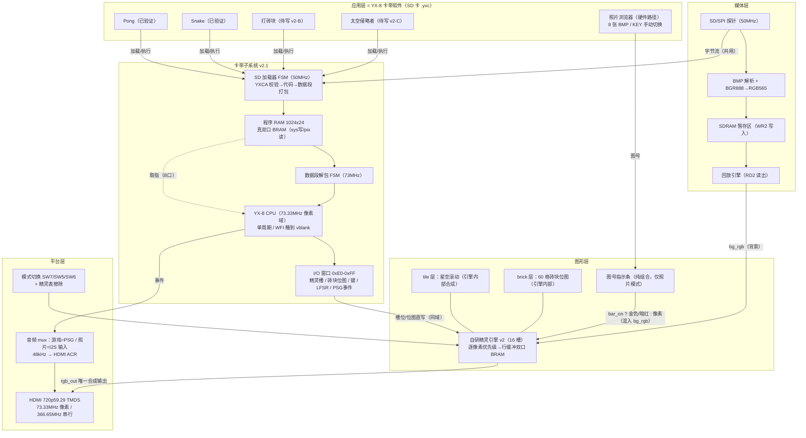

# 映序（YingXu）交接文档 — 2026-10-26

> 本文档由 ZCode 调试会话生成，覆盖当日全部调试内容。目标读者：队友 / 接手的新会话。
> 读本文档即可恢复全部上下文，无需翻阅聊天记录。

---

## 1. 项目背景（一分钟版）

- **映序**：安路 EG4S20（AC201 底板 + AC601-EG4S20 核心板）上的多模式多媒体平台，自主赛道，**初赛作品截止 11.4**。
- **三种模式**（SW7 选）：照片模式（SD BMP → SDRAM → HDMI 720p）/ 游戏模式 / **卡带模式**（自研 YX-8 CPU 跑 SD 卡上的软件游戏）。
- **核心创新点（v2 架构）**：打砖块、侵略者全部从硬件 FSM 迁移为 YX-8 卡带软件，CPU 与精灵引擎同在 73.33MHz 像素域（零 CDC 桥），省 ~1300 LUT。Pong/Snake 汇编已写好。

### 板级开关与 LED（重要，极性不统一！）

| 信号 | 极性 | 说明 |
|---|---|---|
| SW7 | **拨 ON 读 0** | `game_mode = ~sw[7]`：ON=游戏模式，OFF=照片模式 |
| SW5/SW6 | **拨 ON 读 1** | `game_sel2 = ~sw5 ? 2'd2 : ~sw6 ? 2'd1 : 2'd0` |
| 组合 | | **SW7 ON + SW5 OFF + SW6 OFF = 卡带模式**；SW5 ON=侵略者（硬件已删）；SW5+SW6 ON=打砖块（硬件已删） |
| LED0 | | SD 初始化成功（不亮 = 布局抽签失败，见 §5） |
| LED1 | 卡带模式 | **亮 = 加载中/卡死；灭 = 加载完成** |
| LED3 | 卡带模式 | ~1Hz 闪 = 帧心跳（注意：**只证明像素域活着，不证明 CPU 在跑**——frame_cnt 与 CPU 无关） |

---

## 2. YX-8 卡带系统架构（v2.1，本日重写后的现状）

```
sys_clk(50M) 域                          pix_clk(73.33M) 域
┌─────────────────────┐                 ┌──────────────────────────────┐
│ SD 加载器 FSM        │   prog RAM      │ 数据段解包 FSM（CPU释放前）    │
│ 头32B→校验→代码→数据 │ ⇒ A口写        │ ↓                            │
│ (ram_dual_port_     │   (真双口BRAM)  │ YX-8 CPU → I/O 窗口           │
│  simple 模板实例)    │ ⇒ B口读        │   ├ 精灵直写（同域！0 CDC）    │
└─────────────────────┘                 │   ├ 砖块位图 0xE0-0xE7        │
                                        │   └ PSG 事件                  │
                                        └──────────────────────────────┘
```

- **.yxc 格式**：32B 头 `'YXCA'|ver|flags|entry16|code_words16|data_len16|data_addr8|...`，随后代码字（**字节序 [op,A,B]，op 在最前**），最后数据段。
- **数据段策略**：加载器按 3B/字打包进 prog_ram[768..]，元数据 {daddr,dlen} 写 prog_ram[1023]；解包 FSM 在 CPU 释放前铺进 dram（224B LUTRAM）。
- **加载校验**：魔数 'YXCA'（在 hdr_idx==4 检查，第 4 拍才凑齐）、words≤768、数据段必须落在 0x00-0xDF。任一不满足 → 不置 loaded → LED1 常亮报错。
- **CPU 释放时序**：`loaded_p`(2FF同步) → 解包 FSM（up_done）→ **再延迟 2 拍**（up_done_d2）才放行——否则前两拍取到的是解包残留字，`JSR init` 会被跳过（此 bug 已实锤并修复）。
- **I/O 映射 v1.1.2**：0xE0-E7 砖块位图 / 0xE8-F0 精灵暂存(en,xL,xH,yL,yH,w,h,cL,cH) / **0xF1 提交（写槽号原子生效）** / 0xF2 按键 / 0xF3 帧计数 / 0xF4 LFSR(读即前进) / 0xF5 PSG / 0xF6 系统 / 0xFE 分数。
- **精灵引擎（yingxu_sprite_engine）**：16 槽 × 67 位表项 {en,x[10:0],x+w,y[9:0],y+h,color[23:0]}，行缓冲渲染，**h 字段仅 6 位（最大 63！）**，颜色 0x000000 = 透明，tile 层从引擎内部合成输出。
- **关键 ISA 约定**：CMP/CMPI 只改标志不写回；移位量取 B[2:0]；BCC=BCC(无符号<)、BCS=≥；分支目标=PC+1+sext(B)；JMP/JSR 双字（第二字 A 域=目标高 8 位）。

---

## 3. 本日战果：连环 bug 全记录（按发现顺序）

> 背景：v2 重构后板上"Pong 看不到板子和球"。逐层挖出 **7 个真实 bug**，全部修复并仿真验证。

| # | Bug | 后果 | 修复 |
|---|-----|------|------|
| 1 | **U_sprite 实例在重构时被整个删掉**（design_top_wrapper.v） | `S_sprite_rgb` 无驱动，显示管线没有合成器，全黑/只有背景 | 重新挂上（位于 U_tile 之后） |
| 2 | **加载器字节序颠倒**：`prog_ram[w] <= {b2,b1,b0}`，应为 `{b0,b1,b2}` | **板上 CPU 从第一天起就在执行乱码**。共生仿真没抓到——因为测试台用 yxc2hex 的 prog.hex 绕过了加载器！ | 改为 `{b0,b1,sd_data}`；解包取字节顺序同步调整 |
| 3 | **上次 v2 构建根本没编译通过**：`loaded_s` 双重声明 + `loaded_done` 未定义，TD 丢弃整个 cart_soc 模块（证据：out/v2_build.log 的 HDL-8007） | 板上 bit 里**没有卡带子系统** | 全文件重写 |
| 4 | dram 跨时钟双写口（sys 加载器 + pix CPU） | TD 无法正确推断 | 数据段改经程序 RAM 中转 + 像素域解包 FSM，dram 变纯 pix 域单写口 |
| 5 | 数据段尾字打包死等（dlen=16 非 3 的倍数时等不存在的字节） | snake 加载卡死 L_DATA | 1 字尾/2 字尾立即封包 |
| 6 | CPU 释放后前两拍取到解包残留字（元数据 0x000000 当 NOP 执行） | `JSR init` 被跳过 → 游戏变量全部未初始化 | `up_done_d2` 两拍延迟放行 |
| 7 | Pong 板高 64 超出精灵 6 位 h 字段 → 截断为 0（板子隐形） | 板子看不见 | pong.asm `MOVI R0,64` → `63`（两处） |

另外新增：YXCA 魔数校验、entry 从卡带头部取（不再硬编码 0）。

**教训（写进流程）**：以后 RTL 改动必须先跑 SOC 级仿真（`tb/tb_cart_soc.v`，用真实 .yxc 走完整加载路径，绝不绕过加载器）再上板。

---

## 4. 验证与当前烧录状态

- **仿真**：`tb/tb_cart_soc.v`（iverilog）——**PONG PASS**（三精灵逐字段比对：左板 16,176 / 右板 1208,176 / 球 128,360）、**SNAKE PASS**（数据段解包 dram[0x50..]=01 02 04 08、食物精灵 120×28 红、身体走砖块位图）。
- **编译**：项目管理器流程成功。21 块 BRAM（程序 RAM 24Kb 推断成功）。时序健康特征：**HWNS +0.02~0.03ns、SWNS ≈ -0.55（含 TMDS 跨域伪路径，历来如此）、像素域内 +1.05ns**。
- **烧板**：**当前板上 = seed 29**（LED0 亮，SD 活）。seed 28 已证实 SD 死。
- **SD 卡**：LBA 1,000,000 = 新版 pong.yxc（h=63，659B），回读校验 PASS，4 张照片完好。

### 卡带模式当前现象（待诊断）

**只有星空滚动，无球无板。** 星空 = tile 层经精灵引擎合成 → **证明显示链路和引擎本体都活着**，缺的是 CPU 精灵提交。

**已向用户发出的诊断问题（等待回答）**：
1. LED3 闪不闪？→ 闪 = 卡带模式真激活；不闪 = 开关映射没进对模式
2. LED1 亮还是灭？→ **常亮 = 加载卡死**（查 SD 在 LBA 1M 的读取）；**灭 = 已加载**（查提交路径）

---

## 5. 工具链血泪手册（TD / iverilog / SD 卡）

### TD（D:\Anlogic\TD_Release_2026.2.210.850\bin\td_commands_prompt.exe）

```bat
:: 正确调用方式（/script 参数是坏的！必须 stdin 重定向）
td_commands_prompt.exe < script.tcl > log 2>&1
```

- **stdin 模式会吞掉脚本第一行**——脚本第一行必须放无用注释。
- `import_device` 必须带全参数：`import_device eagle_s20.db -package EG4S20BG256`（项目流程里漏了会导致子进程 `can't read "device_name"` 崩）。
- **in-process 流程（optimize_rtl→place→route）当前设计会翻车**：`report_qor -step place`（生成全局布线网格，route 的前置依赖）确定性 coredump；跳过它则 route 报 "0 instance"。**别用 in-process 流程，用项目管理器流程**：

```tcl
### dummy
import_device eagle_s20.db -package EG4S20BG256
open_project {C:/Users/HXF/Desktop/YX/AC201_AL_board_test.al}
reset_runs { syn_1 }
launch_runs { syn_1 phy_1 } -jobs 2
wait_run syn_1 -quiet
wait_run phy_1 -quiet
save_best_bits
exit
```

- **多种子扫描**（SD 死时的解法，约 10 分钟/12 种子）：

```tcl
### dummy
import_device eagle_s20.db -package EG4S20BG256
open_project {C:/Users/HXF/Desktop/YX/AC201_AL_board_test.al}
commit_param -step design
elaborate -top hardware_test
read_sdc C:/Users/HXF/Desktop/YX/timing.sdc
read_adc C:/Users/HXF/Desktop/YX/IO.adc
optimize_rtl
set_seed_param -num 12 -init 28 -step 1 -jobs 4 -save 12 -endStep bitgen -genBit on -random off -filter off
reset_runs phy_1
launch_runs phy_1 -jobs 4
wait_run phy_1 -quiet
exit
```

  种子 bit 落在 `AC201_AL_board_test_Runs/phy_1/seed_N/AC201_AL_board_test.bit`（当前 28-39 已拷为 `out/seed/v3_seed28-39.bit`）。
- **烧板**：

```tcl
### dummy
connect_cable -allink
download -bit <bit路径> -mode program_spi -v -spd 7 -cable 0 -flashsize 128
exit
```

- **布局抽签**：SD 初始化对布局极敏感（历史上 seed 32/77 活过；本网表 28 死 29 活）。时序全绿的 bit 照样可能 SD 死——**时序报告无法预测，只能上板看 LED0**。
- **PHY-1030 "Failed to fix hold"** = 信息性（路由器重试记录），不阻塞；**验收标准 = HWNS > 0**。
- **编程时的坑**：脚本用纯 ASCII；**文本文件一律用 Python 写，严禁 PowerShell Set-Content**（本日 BOM 事故复现）。

### 仿真 / 工具

- **iverilog**：`D:\iverilog\bin\iverilog.exe`（-g2005）+ `vvp.exe`
- **Python**：`C:\Users\HXF\py312\python.exe`（本日装的 3.12.7 嵌入版，工具链零依赖）
- SOC 冒烟：

```bat
D:\iverilog\bin\iverilog.exe -g2005 -o tb.vvp -DCHECK_PONG -DCARTFILE="cartridges/pong.yxc" tb\tb_cart_soc.v src\user_source\hdl_source\yx8_cart_soc.v src\user_source\hdl_source\yx8_cpu.v src\user_source\hdl_source\media\sd\ram_dual_port_simple.v
D:\iverilog\bin\vvp.exe tb.vvp
```

- **SD 卡写卡带**（卡插电脑后）：

```bat
C:\Users\HXF\py312\python.exe tools\write_cart.py --drive E --cart cartridges\pong.yxc --lba 1000000
C:\Users\HXF\py312\python.exe tools\verify_card.py
```

  注意：**卡带槽只有一个**，写 snake 会覆盖 pong，最后写谁板上跑谁。write_cart 自校验分区偏移（照片1 "BM" 头），绝不盲写。

---

## 6. 文件清单（本日动过 / 关键文件）

| 文件 | 状态 |
|---|---|
| `src/user_source/hdl_source/yx8_cart_soc.v` | **本日全重写 v2.1**（修 #2/3/4/5/6 + 魔数/entry） |
| `src/user_source/hdl_source/design_top_wrapper.v` | 修 #1：重挂 U_sprite、删 c_spr_*/tbl_* 双声明、删 U_invaders 死代码（O_inv_wave/lives 恒零） |
| `src/user_source/hdl_source/yx8_cpu.v` | 未动（200k+ 指令共生验证过的，rtl/ 与 hdl_source/ 两份相同） |
| `tb/tb_cart_soc.v` | **本日新增** SOC 冒烟测试台 |
| `cartridges/pong.asm` | h=63 修复（两处）；pong.yxc 209 词 entry=0 无数据段 |
| `cartridges/snake.asm` | 未动；snake.yxc 358 词 + 16B 数据 @0x50 |
| `tools/yxa.py / yxem.py / yxc2hex.py / write_cart.py / verify_card.py` | 未动 |
| `out/v3_proj_build.tcl` | ✅ 项目流程构建（可用） |
| `out/v3_sweep.tcl` | ✅ 12 种子扫描 |
| `out/v3_flash_seed.tcl` | ✅ 单 bit 烧板（改 bit 文件名复用） |
| `out/v3_build.tcl` | ⚠️ in-process 流程——有 route 翻车问题，别用 |
| `out/seed/v3_seed28-39.bit` | 12 个候选 bit（28 死、29 活） |
| `docs/CPU_CART_PLAN.md` / `docs/SPRITE_ENGINE.md` | 架构文档（v1.1.2 规范） |

---

## 7. 下一步（按优先级）

1. **【等用户回答】** 卡带模式 LED1 / LED3 状态 → 二分定位：
   - LED1 常亮 → 查 SD 在 LBA 1,000,000 的读取（重点排查 sd_stream_reader 高地址增量、probe 的 restart 时序；可在仿真里用 tb_cart_soc 复现，或临时把 CART_LBA 改小对照试验）
   - LED1 灭 → 查提交路径（tbl_we 门控、sel_cart、clr_active 状态；tb 里已验证过的逻辑，重点查板上信号实际值——可用 LED 复用打点）
2. Pong 板上全功能验收（板/球/AI/发球/音效）。
3. **打砖块 + 侵略者写成 YX-8 汇编**（v2-B/C；精灵 h≤63、16 槽、砖块位图 60 格的约束都在 §2）。这是初赛"资源极限"叙事的主菜。
4. PS2 手柄接口（v3）、美术路线（调色板 + png2yx）。
5. **11.4 截止**——11.2 前必须冻结可演示版本。

---

## 8. 架构图勘误（v2.1 现状，2026-10-26）

> 队友整理的架构图是 **G3 时代**的版本。已核实的问题：
> ① 缺 YX-8 卡带系统（v2 核心）；② 侵略者/打砖块硬件 FSM 已删除，不应画成应用层实体；
> ③ OSD 已死（yingxu_osd_lite/font8x16/status_bcd 均未实例化，TD 已剪除；照片模式底部的图号条是 wrapper 纯组合逻辑）；
> ④ 媒体层数据流方向反了（SDRAM 回放是精灵引擎的**输入**，不是它的下游）；
> ⑤ 缺 tile 层与 brick 层；⑥ 照片是 KEY 手动切换，无自动轮播。

### 修正版（Mermaid 源码，可直接粘到 draw.io / mermaid.live）



### 文本版（一眼图）

```
应用层   Pong │ Snake │ 打砖块* │ 侵略者*        *=待写汇编,现为YX-8软件
              │ .yxc（SD卡 LBA 1,000,000）
              ▼
卡带子系统   SD加载器(50M) → 程序RAM(双口BRAM) → 解包FSM → YX-8 CPU(73M,像素域)
                                                      │ I/O窗: 精灵槽/砖块/键/PSG
                                                      ▼ 同域直写,零CDC
图形层      精灵引擎(16槽+行缓冲) ← bg_rgb ← SDRAM回放(RD2) ← SD→BMP→RGB565→暂存(WR2)
            （tile星空、brick 60格在引擎内部合成；OSD已删除）
                                                      ▼ rgb_out 唯一输出口
平台层      模式切换(SW7/SW5/SW6) · 音频mux(PSG/I2S, 48k) · HDMI 720p59.29 TMDS
```
